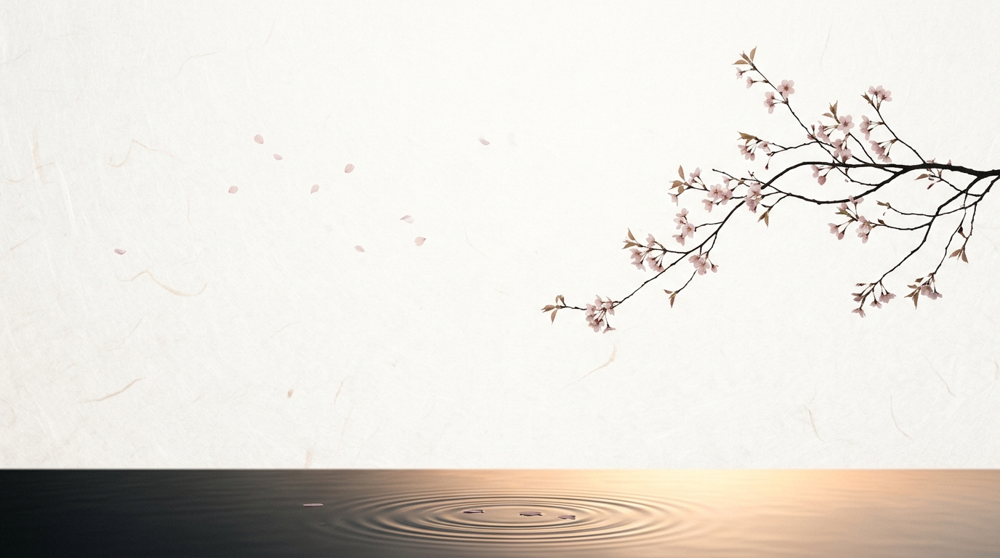
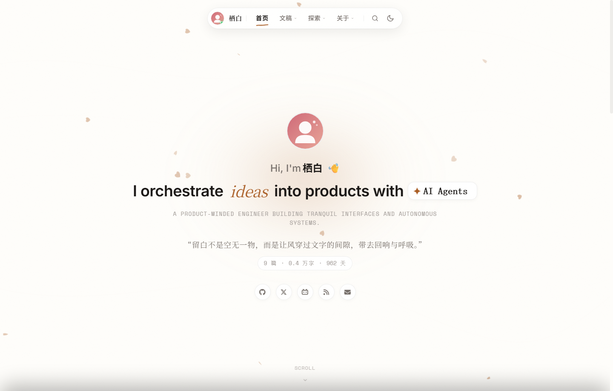
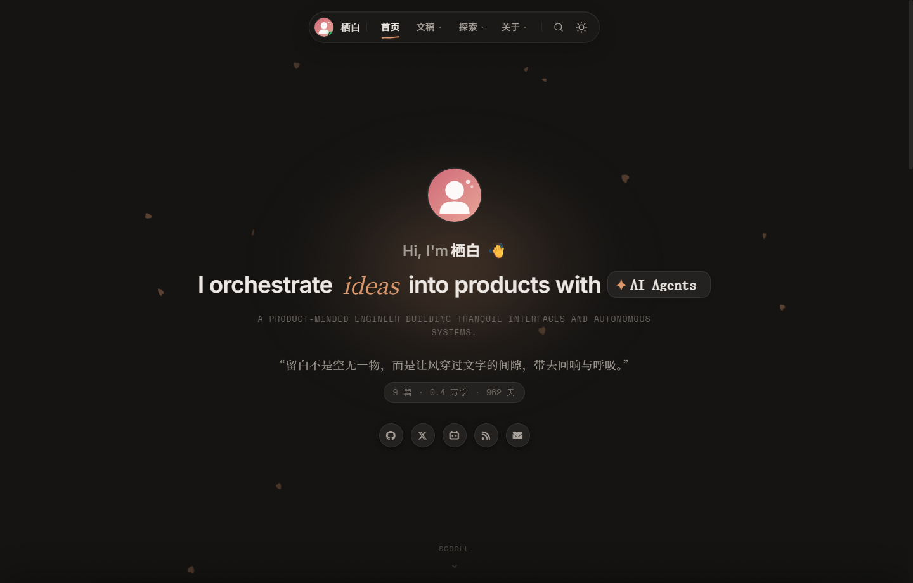
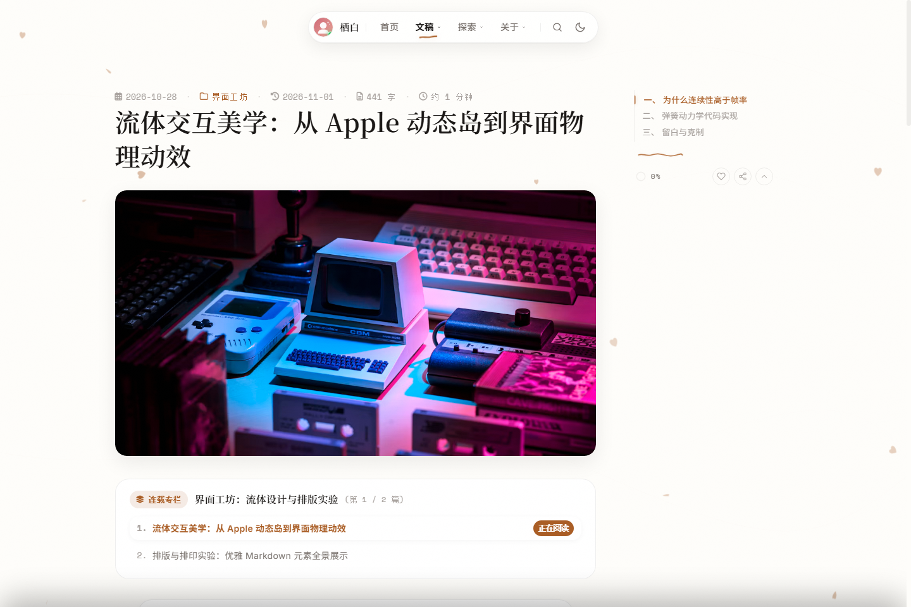
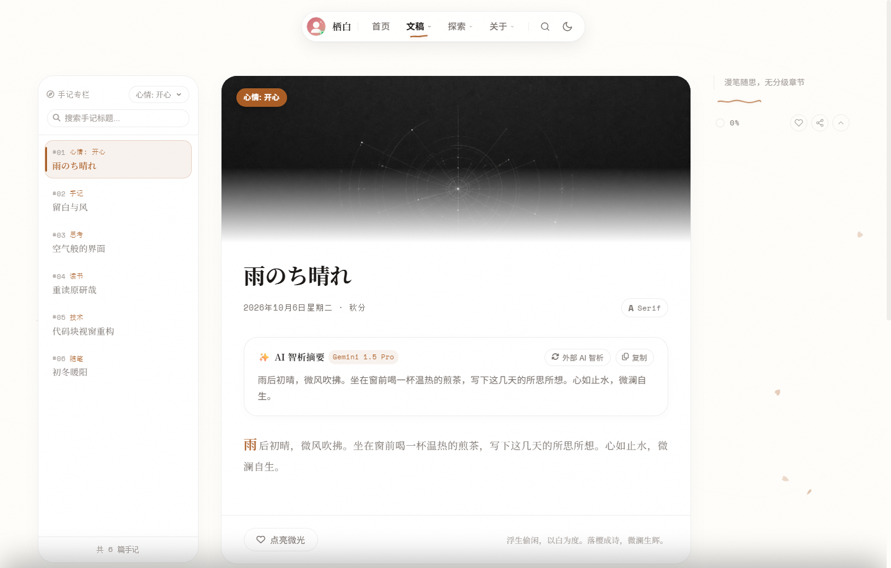
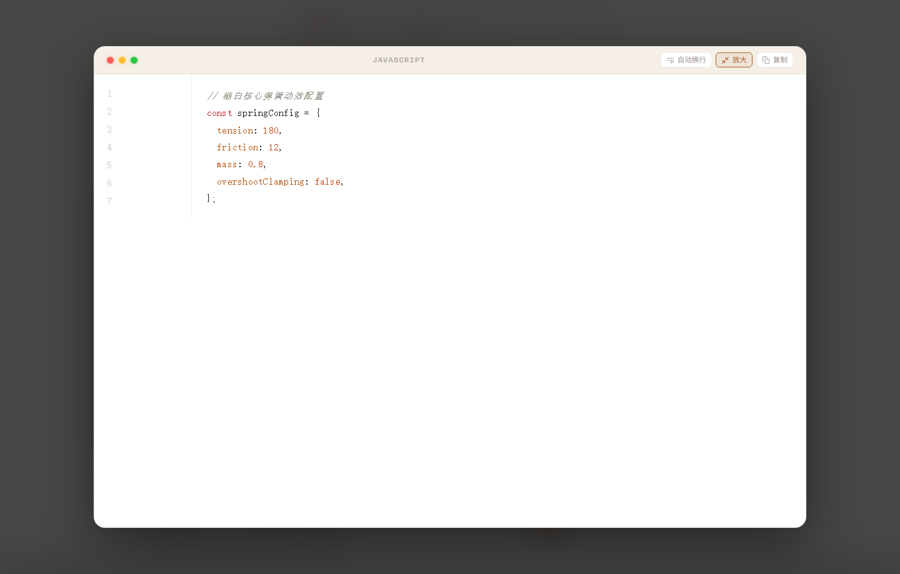

# 🍃 Seihaku (栖白)

<p align="center">
  
</p>

<p align="center">
  <strong>Find tranquility in negative space; let drifting sparks dwell in clarity.</strong><br>
  <em>A tranquil, product-minded Hexo theme blending Japanese Yohaku (余白) minimalism, Apple HIG fluid dynamic island interactions, and tri-lingual aesthetic typography.</em>
</p>

<p align="center">
  <a href="README.md">简体中文</a> •
  <a href="README.en.md"><b>English</b></a> •
  <a href="README.ja.md">日本語</a>
</p>

<p align="center">
  <a href="https://github.com/kuailiaojie/Seihaku/releases/tag/v0.1.0"></a>
  <a href="https://www.npmjs.com/package/hexo-theme-seihaku"></a>
  <a href="https://opensource.org/licenses/MIT"></a>
  <a href="https://hexo.io/"></a>
  <a href="#-native-tri-lingual-internationalization-i18n"></a>
  <a href="https://github.com/kuailiaojie/Seihaku/stargazers"></a>
</p>

---

## 🎨 Visual Preview

### 1. Dual Aesthetics (Light & Dark Mode)
> Pure washi paper white and warm charcoal paper texture, complemented by physics-driven cursor-repelling cherry blossom petal particles and subtle organic grain.

| Light Mode | Dark Mode |
| :---: | :---: |
|  |  |

---

### 2. Immersive Reading & Floating Table of Contents
> 740px golden reading width, 1.92 humanistic line height, responsive table of contents, and a top dynamic reading progress bar.

<p align="center">
  
</p>

---

### 3. Tranquil Notes & Code Lightbox Modal
> Card-stream musings column; macOS realistic code blocks supporting one-click copy, word wrap, and full-screen lightbox zoom modal with zero pixel offset.

| Tranquil Notes Column | Code Block Lightbox Zoom |
| :---: | :---: |
|  |  |

---

## ✨ Highlights

* 🌿 **Yohaku (余白) Negative Space Philosophy**: Strict adherence to a 720~760px golden reading viewport and 1.92 comfortable line height, banishing wide-screen claustrophobia and digital clutter.
* 🌸 **Petal Breeze Particle Physics**: Delicate washi grain canvas overlay with gently drifting cherry blossom petals that smoothly repel away from the mouse cursor.
* 📱 **Apple HIG Fluid Dynamic Island**:
  * **Top Island Capsule**: Adaptive contracting navigation bar, online status badge, live jumping green audio visualizer bars, and hand-drawn wave underline indicators.
  * **Mobile Floating Island**: Ergonomic one-handed floating control dock and fluid sheet drawer for table of contents.
* 💻 **macOS Realistic Code Block Engine**:
  * macOS tri-color microcrystalline window dots with centered language badge.
  * **Full-Screen Lightbox Zoom**: Click the green dot or fullscreen button to pop the code block into a smooth modal with GSAP spring physics; restored with exact pixel precision and zero layout jump.
  * Height-limit glassmorphism gradient fold, code line counts, instant copy feedback, and word-wrap toggle.
* 📡 **Decentralized Friend Circle RSS Live Aggregation**:
  * Built-in asynchronous RSS/Atom feed parser.
  * Add friends' feed URLs to your config; Hexo fetches and compiles the latest musings automatically at build time.
* 🌐 **Native Tri-lingual Internationalization (i18n)**:
  * Out-of-the-box support for **Simplified Chinese (`zh-CN`)**, **English (`en`)**, and **Japanese (`ja`)**.
  * Japanese typography and wording carefully aligned with traditional Wabi-Sabi and Yohaku aesthetics.
* 🤖 **AI Summary Engine & Instant ⌘K Search**:
  * Support for static Front-matter summaries and external AI API analysis of core article viewpoints.
  * Sub-millisecond fuzzy search indexing across all posts, musings, categories, and tags.
* 💎 **Zero Content Preset**:
  * Complete structural templates for all showcase pages with clean empty arrays `[]`—free from fake dummy data pollution.

---

## 🚀 Quick Start (3 Minutes)

### Method A: Install via npm (Recommended)

In your Hexo root directory:

```bash
npm install hexo-theme-seihaku --save
```

### Method B: Clone from GitHub

```bash
git clone https://github.com/kuailiaojie/Seihaku.git themes/seihaku
```

---

### 2. Enable Theme in Hexo Config

Edit `_config.yml` in your Hexo root:

```yaml
theme: seihaku
language: en # Options: zh-CN | en | ja
```

### 3. Initialize Pages & Decoupled Configuration

Run the theme's built-in scaffold CLI:

```bash
npx hexo seihaku:init
```

> This automatically creates `_config.seihaku.yml` in your site root (safely decoupled from theme updates) and sets up all 15 specialized showcase pages.

### 4. Start Local Development Server

```bash
npx hexo server
```

Open `http://localhost:4000` in your browser to enter your tranquil Seihaku sanctuary!

---

## 🏛️ Specialized Showcase Matrix

Seihaku provides 15 dedicated showcase pages out of the box:

| Route | Page Name | Features |
| :--- | :--- | :--- |
| `/` | **Home Sanctuary** | Hero typewriter, Hitokoto poetic strip, Recent Writing & Musings dual stream |
| `/archives/` | **Archives** | Chronological timeline, total word count metrics, category pills |
| `/notes/` | **Tranquil Notes** | Micro-blogging inspiration stream with instant search and topics |
| `/timeline/` | **Timeline** | Dual-track milestones combining writings and life reflections |
| `/categories/` | **Categories** | Structured knowledge manuals and reading guides |
| `/tags/` | **Tags Gallery** | Glowing capsule tag cloud with article linkages |
| `/docs/` | **Docs Center** | In-depth engineering manuals and documentation columns |
| `/portfolio/` | **Creations** | Independent products and open-source project showroom |
| `/bangumis/` | **Anime Journey** | Animation tracker with optional automatic Bilibili API sync |
| `/steam/` | **Steam Cosmos** | Gaming as the ninth art, achievements, and play logs |
| `/equipments/` | **Productivity Gears**| Desktop, digital, audio, and camera gear inventory |
| `/photos/` | **Light & Shadow** | Fluid photography album, full-screen lightbox, and EXIF metadata |
| `/friends/` | **Kindred Spirits** | Elegant link cards with link exchange guidelines |
| `/friendcircle/`| **Friend Circle** | Decentralized RSS live stream automatically aggregated from friends' feeds |
| `/guestbook/` | **Guestbook** | Negative space echoes board with Waline / Twikoo / Giscus support |
| `/about/` | **About Seihaku** | Personal persona, spatial pulse metrics, and social badges |

---

## ⚙️ Decoupled Configuration (`_config.seihaku.yml`)

All user preferences can be customized inside `_config.seihaku.yml` in your root directory:

```yaml
# 1. Identity & Style
author:
  name: "Seihaku"
  avatar: "/images/avatar.svg"
  signature: "Find tranquility in negative space."
style:
  preset: "sakura" # sakura | bamboo | indigo | charcoal

# 2. Top Dynamic Island
island:
  enable: true
  music:
    enable: true
    title: "Tranquil Flow"
    artist: "Seihaku"

# 3. Home Stream & Hero
hero:
  greeting: "Hi, I'm"
  typing_texts: ["Fluid UI Design.", "Minimalist Engineering.", "Digital Tranquility."]
hitokoto:
  enable: true
  auto_refresh: true
  interval: 8500

# 4. Code Blocks
code_block:
  mac_dots: true
  copy_button: true
  word_wrap: true
  height_limit: 380

# 5. Friend Circle RSS Live Aggregation
friendcircle:
  enable: true
  auto_sync: true
  limit: 25
  sources:
    - name: "Innei"
      url: "https://innei.in"
      feed: "https://innei.in/feed"
```

---

## 🛠️ CLI Commands

```bash
# Initialize all showcase pages and decoupled config
npx hexo seihaku:init

# Force overwrite and reset default page structure
npx hexo seihaku:init --force

# Manually trigger RSS feed and platform data sync
npx hexo seihaku:sync

# Run environment and dependency integrity diagnostics
npx hexo seihaku:doctor
```

---

## 🙏 Acknowledgements & Tribute

The aesthetic philosophy, fluid dynamic island interactions, and tranquil breathing space of this theme are deeply inspired by brilliant creators in the open-source community:

* **[Innei](https://innei.in) ([innei.dev](https://innei.dev))**: Sincere tribute and gratitude to Innei for pioneering exceptional design paradigms (including [Shiro](https://github.com/innei/shiro) and [Kami](https://github.com/innei/kami)). The minimalist digital craftsmanship, dynamic top navigation island, hand-drawn wave underline indicators, and relentless attention to interface tactility served as the foundational inspiration for Seihaku.
* **[Hexo](https://hexo.io/)**: Fast, simple, and powerful static site framework.
* **[GSAP](https://greensock.com/gsap/)**: Industry-leading animation engine powering our fluid spring physics.

---

## 📄 License

This project is licensed under the [MIT License](LICENSE). Feel free to customize, fork, and share!

<p align="center">
  Made with 🍃 and tranquility by <a href="https://github.com/kuailiaojie">kuailiaojie</a>.
</p>
