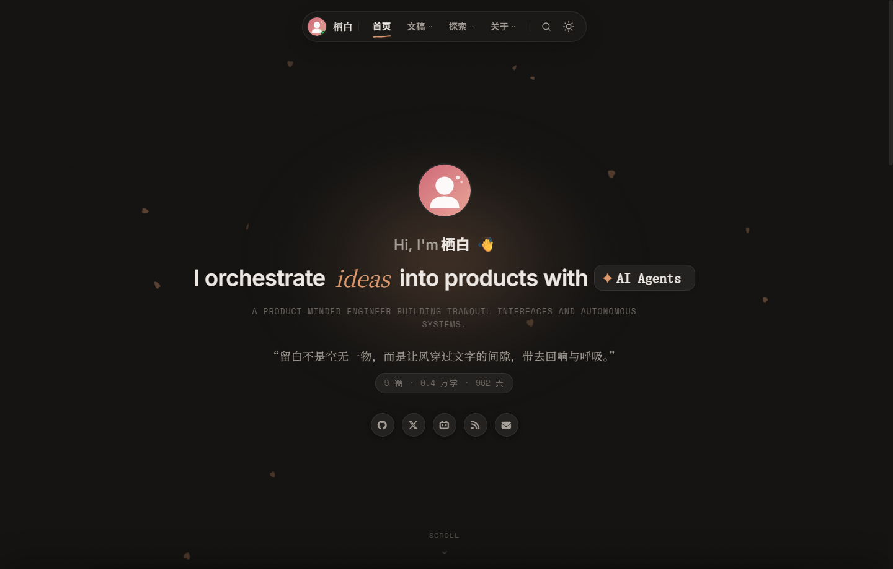
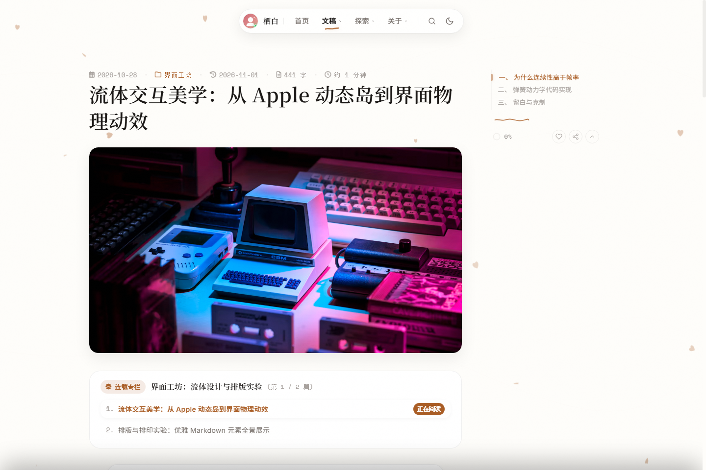
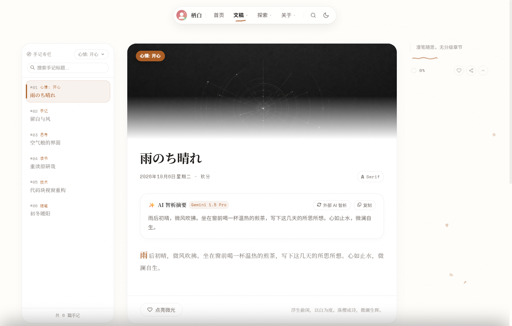
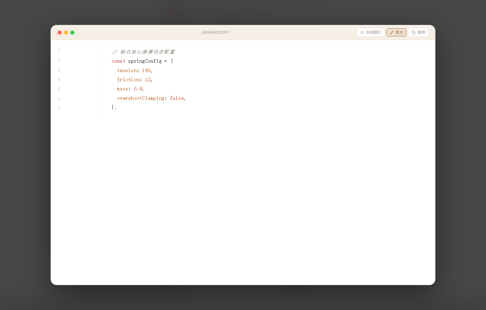

# 🍃 栖白 (Theme Seihaku)

<p align="center">
  
</p>

<p align="center">
  <strong>浮生に息抜き、余白を以て度とす。舞い散る桜は詩となり、静かな波紋が光を宿す。</strong><br>
  <em>日本の「余白 (Yohaku)」の美学、Apple HIG の流体ダイナミックアイランド、そして三言語の調和を追求した Hexo ブログテーマ。</em>
</p>

<p align="center">
  <a href="README.md">简体中文</a> •
  <a href="README.en.md">English</a> •
  <a href="README.ja.md"><b>日本語</b></a>
</p>

<p align="center">
  <a href="https://github.com/kuailiaojie/Seihaku/releases/tag/v0.1.0"></a>
  <a href="https://www.npmjs.com/package/hexo-theme-seihaku"></a>
  <a href="https://opensource.org/licenses/MIT"></a>
  <a href="https://hexo.io/"></a>
  <a href="#-三言語国際化対応-internationalization"></a>
  <a href="https://github.com/kuailiaojie/Seihaku/stargazers"></a>
</p>

---

## 🎨 ビジュアルプレビュー (Visual Preview)

### 1. 二つの外観（ライト・ダークモード）
> 澄んだ和紙の白と、温もりある木炭の黒。風に舞う桜の花びらはカーソルから軽やかに退避し、繊細な紙のノイズ質感が空間を包みます。

| ライトモード (Light Mode) | ダークモード (Dark Mode) |
| :---: | :---: |
|  |  |

---

### 2. 没入感ある記事読書と追従目次 (Post & Typography)
> 740px の黄金読書エリア、1.92 の心地よい行間。右上に適応するダイナミック目次とトップの読書進捗バー。

<p align="center">
  
</p>

---

### 3. 微語手記ストリームとコードブロック拡大表示 (Notes & Code Lightbox)
> カードストリーム形式の手記カラム。macOS リアルコードブロックはワンクリックコピー、自動折り返し、そしてズレのない全画面拡大フォーカスモーダルに対応。

| 微語手記ストリーム (Notes Stream) | コードブロック拡大モーダル (Code Lightbox) |
| :---: | :---: |
|  |  |

---

## ✨ 主な特長 (Features)

* 🌿 **「余白 (Yohaku)」の美学**：720〜760px の黄金読書幅と 1.92 の快適な行間を徹底追求。ワイド画面による圧迫感や情報のノイズから解放します。
* 🌸 **桜の花びらパーティクルと物理避譲**：純粋な CSS と Canvas による和紙テクスチャ。舞い散る花びらはマウスカーソルを自然に避けて漂います。
* 📱 **Apple HIG 流体ダイナミックアイランド**：
  * **トップダイナミックアイランド**：適応伸縮ナビゲーション、オンラインステータスバッジ、緑に跳ねるオーディオ波形バー、手描き波線のアクティブインジケーター。
  * **モバイル用フローティングドック**：片手操作に最適化したフローティングバーとスムーズな引き出し式目次シート。
* 💻 **macOS リアルコードブロックエンジン**：
  * macOS の 3 色ドットと中央言語バッジ。
  * **全画面拡大フォーカス (Code Lightbox)**：緑ドットまたは拡大ボタンで中央にスムーズに展開。GSAP スプリング物理アニメーションにより、元の位置へズレなく完璧に復帰。
  * 長文コードのグラデーション折りたたみ、行数カウント、コピー完了フィードバック、折り返し切り替え。
* 📡 **分散型 RSS 友隣の輪（自動アグリゲーション）**：
  * 軽量な非同期 RSS/Atom パーサーを内蔵。
  * 設定ファイルに友人のブログ購読 URL を追加するだけで、Hexo ビルド時に自動で最新記事を集約します。
* 🌐 **ネイティブ三言語国際化 (i18n)**：
  * **簡体字中国語 (`zh-CN`)**、**英語 (`en`)**、**日本語 (`ja`)** を標準サポート。
  * 日本語の語彙や言い回しは、伝統的な侘び寂びと余白の文脈に深く寄り添っています。
* 🤖 **AI 要約解析エンジンと高速 ⌘K 検索**：
  * 記事ごとの静的要約および外部 AI API による長文要約解析に対応。
  * 記事、手記、カテゴリー、タグをミリ秒単位でリアルタイムにあいまい検索。
* 💎 **ゼロ汚染プリセット (Zero Content Preset)**：
  * すべての専用ページに完全な設定構造を標準装備。ダミーデータを排除し、空配列 `[]` から気持ちよく始められます。

---

## 🚀 クイックスタート (Quick Start)

### 方法 A: npm からインストール（推奨）

Hexo サイトのルートディレクトリで実行します：

```bash
npm install hexo-theme-seihaku --save
```

### 方法 B: GitHub からクローン

```bash
git clone https://github.com/kuailiaojie/Seihaku.git themes/seihaku
```

---

### 2. テーマを有効化

Hexo ルートディレクトリの `_config.yml` を編集します：

```yaml
theme: seihaku
language: ja # 選択肢: zh-CN | en | ja
```

### 3. 専用ページと分離設定を一括初期化

テーマ内蔵の自動化 CLI を実行します：

```bash
npx hexo seihaku:init
```

> ルートディレクトリにテーマ本体と完全に分離された `_config.seihaku.yml` が自動生成され、15 の専用ページ構造がセットアップされます。テーマ更新時も設定が衝突しません。

### 4. ローカルサーバーを起動

```bash
npx hexo server
```

ブラウザで `http://localhost:4000` を開くと、静寂と余白に満ちた栖白の庭園が広がります！

---

## 🏛️ 専用ページマトリックス (Showcase Matrix)

栖白は導入直後から 15 の専用ページを提供します：

| ルート | ページ名 | 特徴 |
| :--- | :--- | :--- |
| `/` | **庭園ホーム** | タイプライター Hero、一言詩韻回廊、記事＆手記のデュアルストリーム |
| `/archives/` | **記事一覧** | 時系列タイムライン、文字数統計、カテゴリータグフィルター |
| `/notes/` | **微語手記** | ひらめきや思索のカードストリーム、即時検索とトピック分類 |
| `/timeline/` | **時の軌跡** | 執筆と日常の思索が交差するデュアル年表 |
| `/categories/` | **カテゴリー一覧** | 構造化された技術マニュアルと読書案内 |
| `/tags/` | **タグギャラリー** | カプセルタグクラウドと関連記事一覧 |
| `/docs/` | **ドキュメント** | 体系的なエンジニアリング設計マニュアル・連載コラム |
| `/portfolio/` | **精選作品** | 個人プロジェクト・オープンソース開発展示ホール |
| `/bangumis/` | **アニメ巡礼録** | アニメ作品記録（Bilibili API 自動同期対応） |
| `/steam/` | **Steam 回廊** | 第九の芸術としてのゲーム体験と実績ログ |
| `/equipments/` | **生産性ギア** | デスク環境、デジタル機器、撮影機材リスト |
| `/photos/` | **光影回廊** | 流体フォトアルバム、フルスクリーン相片ライトボックス、EXIF 読み込み |
| `/friends/` | **友隣リンク集** | エレガントなリンクカードと相互リンク案内 |
| `/friendcircle/`| **友隣の輪** | 友人の RSS を自動アグリゲーションした分散型タイムライン |
| `/guestbook/` | **芳名帳** | 余白の木霊板。Waline / Twikoo / Giscus コメントシステムに対応 |
| `/about/` | **栖白について** | プロフィール、空間拍動メトリクス、ソーシャルバッジ群 |

---

## ⚙️ 設定の分離仕様 (`_config.seihaku.yml`)

カスタマイズ項目はすべてルートの `_config.seihaku.yml` で管理できます：

```yaml
# 1. ブランドとアイデンティティ
author:
  name: "栖白"
  avatar: "/images/avatar.svg"
  signature: "浮生に息抜き、余白を以て度とす。"
style:
  preset: "sakura" # sakura (桜) | bamboo (竹青) | indigo (藍) | charcoal (墨)

# 2. トップダイナミックアイランド
island:
  enable: true
  music:
    enable: true
    title: "Tranquil Flow"
    artist: "Seihaku"

# 3. ホームストリーム
hero:
  greeting: "Hi, I'm"
  typing_texts: ["Fluid UI Design.", "Minimalist Engineering.", "Digital Tranquility."]
hitokoto:
  enable: true
  auto_refresh: true
  interval: 8500

# 4. コードブロック
code_block:
  mac_dots: true
  copy_button: true
  word_wrap: true
  height_limit: 380

# 5. 友隣 RSS 自動同期
friendcircle:
  enable: true
  auto_sync: true
  limit: 25
  sources:
    - name: "Innei"
      url: "https://innei.in"
      feed: "https://innei.in/feed"
```

---

## 🛠️ テーマ CLI コマンド

```bash
# 全ページと分離設定を一括初期化
npx hexo seihaku:init

# デフォルトページ構造を強制上書きリセット
npx hexo seihaku:init --force

# 友隣 RSS と外部プラットフォームの手動同期
npx hexo seihaku:sync

# 実行環境、依存関係、ルーティングの健全性チェック
npx hexo seihaku:doctor
```

---

## 🙏 謝辞と敬意 (Acknowledgements)

本テーマのデザイン思想、ダイナミックアイランドのインタラクション、そして余白の呼吸感は、オープンソースコミュニティの偉大なクリエイターたちから多大なインスピレーションを受けています：

* **[Innei](https://innei.in) ([innei.dev](https://innei.dev))**：極上のデザインパラダイム（[Shiro](https://github.com/innei/shiro) や [Kami](https://github.com/innei/kami) など）を切り拓いた Innei に心からの敬意と感謝を捧げます。ミニマリズムのデジタルクラフトマンシップ、トップナビゲーションのダイナミックな触感、手描き波線インジケーターへのこだわりは、「栖白」の設計思想における最大のインスピレーション源となりました。
* **[Hexo](https://hexo.io/)**：高速でシンプル、拡張性に優れた静的サイトジェネレーター。
* **[GSAP](https://greensock.com/gsap/)**：流れるような物理スプリングアニメーションを提供する最高峰の動効エンジン。

---

## 📄 ライセンス (License)

本プロジェクトは [MIT License](LICENSE) のもとで公開されています。自由なカスタマイズや開発をお楽しみください！

<p align="center">
  Made with 🍃 and tranquility by <a href="https://github.com/kuailiaojie">kuailiaojie</a>.
</p>
