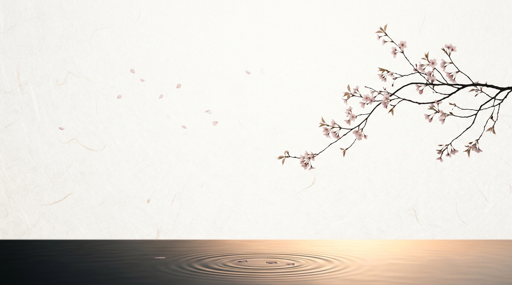
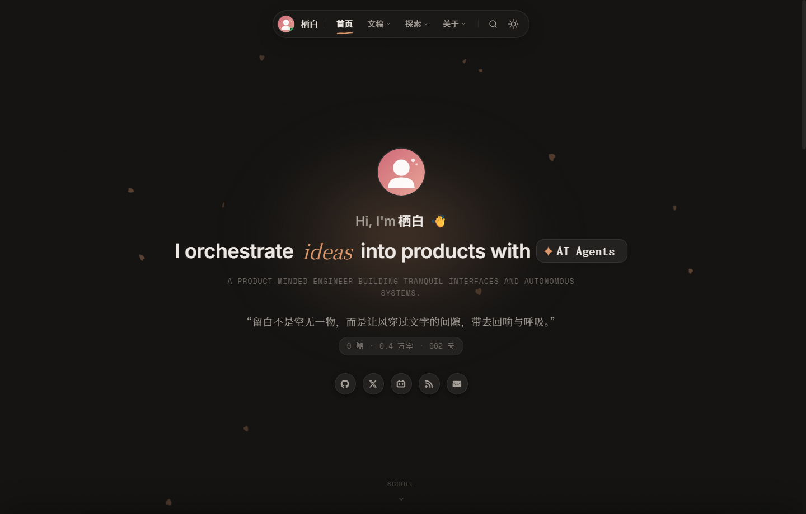
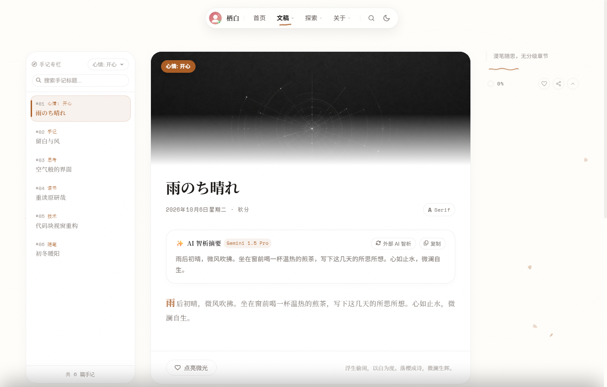
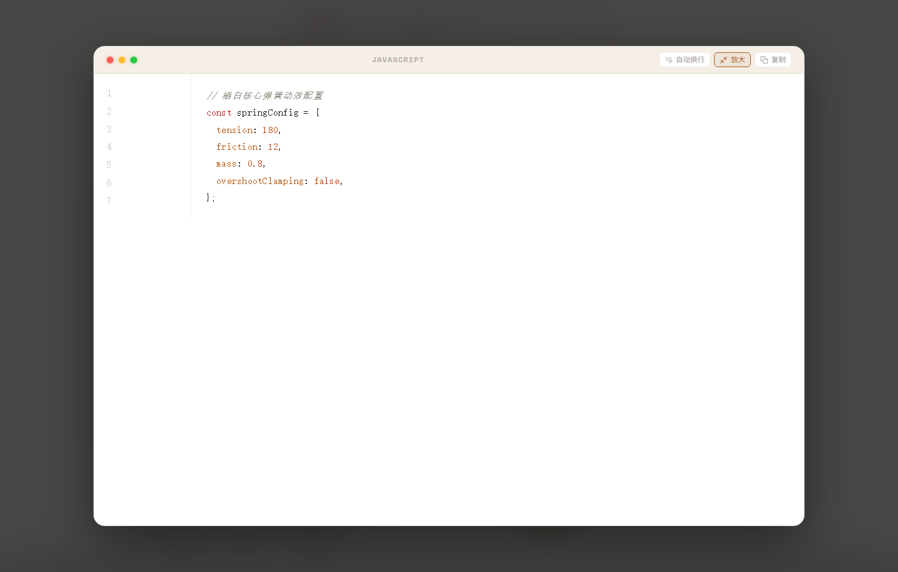

# 🍃 栖白 (Theme Seihaku)

<p align="center">
  
</p>

<p align="center">
  <strong>浮生偷闲，以白为度。落樱成诗，微澜生辉。</strong><br>
  <em>A tranquil, product-minded Hexo theme blending Japanese Yohaku (余白) minimalism, Apple HIG fluid dynamic island interactions, and tri-lingual aesthetic typography.</em>
</p>

<p align="center">
  <a href="README.md"><b>简体中文</b></a> •
  <a href="README.en.md">English</a> •
  <a href="README.ja.md">日本語</a>
</p>

<p align="center">
  <a href="https://github.com/kuailiaojie/Seihaku/releases/tag/v0.1.0"></a>
  <a href="https://opensource.org/licenses/MIT"></a>
  <a href="https://hexo.io/"></a>
  <a href="#-原生三语国际化支持-internationalization"></a>
  <a href="https://github.com/kuailiaojie/Seihaku/stargazers"></a>
</p>

---

## 🎨 视觉预览 (Visual Preview)

### 1. 首页双形态 (Light & Dark Mode)
> 纯净和风宣纸白与温暖炭黑质感，配合环境落樱微风物理避让粒子与细腻噪点底纹。

| 浅色外观 (Light Mode) | 深色外观 (Dark Mode) |
| :---: | :---: |
|  |  |

---

### 2. 沉浸式文稿阅读与随动目录 (Post & Typography)
> 740px 黄金阅读视界，1.92 人文舒适行高，配以右上角自适应灵动目录与顶部阅读进度指示。

<p align="center">
  
</p>

---

### 3. 微语手记专栏与代码块放大聚焦 (Notes & Code Lightbox)
> 独立卡片流手记专栏；macOS 拟真代码块支持一键复制、自动换行与全屏放大聚焦模式（无偏位零跳动）。

| 微语手记专栏 (Notes Stream) | 代码块聚焦放大 (Code Lightbox) |
| :---: | :---: |
|  |  |

---

## ✨ 核心特性 (Features)

* 🌿 **Yohaku (余白) 哲学排版**：严格恪守 720~760px 黄金阅读文本视界与 1.92 人文行高，彻底告别宽屏压迫感与杂乱信息噪音。
* 🌸 **落樱微风物理粒子**：基于纯 CSS 与 Canvas 打造的宣纸底纹微噪点，落樱花瓣具备自然漂浮与鼠标光标物理轻柔避让动效。
* 📱 **Apple HIG 流体质感交互**：
  * **顶栏灵动胶囊**：自适应收缩导航、状态胶囊、跳动绿色音频频谱条与手绘波浪下划线指示器。
  * **移动端交互底栏**：贴合单手操作的悬浮流体控制底栏与平滑抽屉目录面板。
* 💻 **macOS 拟真代码块引擎**：
  * macOS 经典三色微晶圆点与语言居中标识。
  * **全屏放大聚焦 (Code Lightbox)**：点击绿点或全屏按钮，代码块平滑居中弹出，配合 GSAP 物理阻尼微动效；复原时毫秒级像素对齐，杜绝偏移跳动。
  * 智能代码限高折叠遮罩、代码行数统计、一键平滑复制反馈与自动换行切换。
* 📡 **去中心化友邻朋友圈 RSS 自动抓取**：
  * 内置 RSS/Atom 轻量异步抓取适配器。
  * 在配置文件中填入友邻博客订阅源，Hexo 构建期自动实时聚合抓取最新动态，无需手动维护。
* 🌐 **原生三语国际化 (i18n)**：
  * 开箱即用支持 **简体中文 (`zh-CN`)**、**English (`en`)** 与 **日本語 (`ja`)**。
  * 日语词条深度契合「余白」与「侘寂」美学语境。
* 🤖 **AI 智析摘要与全站 ⌘K 检索**：
  * 支持本地静态文摘与外部 AI 接口解析长文核心要点。
  * 毫秒级全站文稿、手记、分类与标签实时模糊检索。
* 💎 **零污染纯净预设 (Zero Content Preset)**：
  * 预设全套独立页面字段规范，列表默认保持干净空数组 `[]`，彻底杜绝示例垃圾数据。

---

## 🚀 3 分钟快速起步 (Quick Start)

### 1. 安装主题

进入您的 Hexo 站点根目录，克隆本仓库到 `themes/seihaku`：

```bash
git clone https://github.com/kuailiaojie/Seihaku.git themes/seihaku
```

### 2. 启用主题

修改站点根目录下的 `_config.yml`：

```yaml
theme: seihaku
language: zh-CN # 可选: zh-CN | en | ja
```

### 3. 一键初始化全套页面与解耦配置

运行主题内置的自动化脚手架：

```bash
npx hexo seihaku:init
```

> 该命令将自动在站点根目录生成与主题源码彻底解耦的 `_config.seihaku.yml`，并自动创建全套 15 个特色专栏页面。升级主题源码永不冲突！

### 4. 启动本地预览

```bash
npx hexo server
```

在浏览器打开 `http://localhost:4000`，即可步入静谧从容的栖白庭院！

---

## 🏛️ 体系化页面矩阵 (Showcase Matrix)

主题开箱即提供 15 个独立专栏页面（均采用统一流体纸墨设计语言）：

| 页面路由 | 专栏名称 | 功能特色 |
| :--- | :--- | :--- |
| `/` | **庭院首页** | 巨幕打字机 Hero、一言诗韵长廊、近期笔墨与碎念双流网格 |
| `/archives/` | **文稿归档** | 时序瀑布流、万字全站统计、分类过滤胶囊 |
| `/notes/` | **微语手记** | 灵感随想卡片流、即时搜索与主题归类 |
| `/timeline/` | **时光足迹** | 融合文稿发布与生活随笔的双轨时空轴 |
| `/categories/` | **分类专栏** | 结构化专栏知识手册与阅读指引 |
| `/tags/` | **标签画廊** | 多彩微光胶囊标签云与文章关联 |
| `/docs/` | **文档中心** | 深度工程手册、系列文档专栏 |
| `/portfolio/` | **精选作品** | 个人项目、开源作品造物展厅 |
| `/bangumis/` | **追番记录** | 动画作品归档，支持 Bilibili API 自动同步 |
| `/steam/` | **Steam 展馆** | 游戏艺术体验与成就展示 |
| `/equipments/` | **生产力装备** | 桌面、数码与摄影设备清单 |
| `/photos/` | **光影画廊** | 流体相册、全屏相片灯箱与 EXIF 元数据 |
| `/friends/` | **友邻聚落** | 优雅友链卡片展示与交换指南 |
| `/friendcircle/` | **友邻朋友圈** | 去中心化友邻 RSS 动态自动聚合流 |
| `/guestbook/` | **访客留言** | 留白回响板，集成 Waline / Twikoo / Giscus 评论 |
| `/about/` | **关于栖白** | 个人画像、空间脉动状态指标与社交徽章矩阵 |

---

## ⚙️ 配置解耦规范 (`_config.seihaku.yml`)

主题支持所有用户自定义项保存在根目录 `_config.seihaku.yml` 中：

```yaml
# 1. 品牌与视觉
author:
  name: "栖白"
  avatar: "/images/avatar.svg"
  signature: "浮生偷闲，以白为度。"
style:
  preset: "sakura" # sakura (樱粉) | bamboo (竹青) | indigo (青蓝) | charcoal (墨黑)

# 2. 顶栏灵动岛
island:
  enable: true
  music:
    enable: true
    title: "Tranquil Flow"
    artist: "Seihaku"

# 3. 首页展示流
hero:
  greeting: "Hi, I'm"
  typing_texts: ["Fluid UI Design.", "Minimalist Engineering.", "Digital Tranquility."]
hitokoto:
  enable: true
  auto_refresh: true
  interval: 8500

# 4. 代码块
code_block:
  mac_dots: true
  copy_button: true
  word_wrap: true
  height_limit: 380

# 5. 友邻朋友圈 RSS 自动同步
friendcircle:
  enable: true
  auto_sync: true
  limit: 25
  sources:
    - name: "Innei"
      url: "https://innei.in"
      feed: "https://innei.in/feed"
```

---

## 🛠️ CLI 常用指令 (Theme CLI)

```bash
# 初始化全套专栏页面与配置文件
npx hexo seihaku:init

# 强制覆盖重置默认页面结构
npx hexo seihaku:init --force

# 手动抓取友邻 RSS 与 Bilibili 追番数据
npx hexo seihaku:sync

# 运行环境、依赖与路由完整性自检
npx hexo seihaku:doctor
```

---

## 🙏 致敬与鸣谢 (Acknowledgements)

本主题的设计审美、灵动岛交互与呼吸感留白深度汲取了开源社区优秀创作者的智慧，在此致以诚挚的敬意与感谢：

* **[Innei](https://innei.in) ([innei.dev](https://innei.dev))**：特别致敬 Innei 及其开源作品（如 [Shiro](https://github.com/innei/shiro) 与 [Kami](https://github.com/innei/kami)）。其对现代 Web 极简美学的开拓、顶栏灵动交互、手绘波浪下划线指示器以及对数字手工艺品般的执着追求，为「栖白」的设计与实现提供了至关重要的灵感源泉。
* **[Hexo](https://hexo.io/)**：快速、简洁且高效的现代化静态博客框架。
* **[GSAP](https://greensock.com/gsap/)**：带来高品质物理阻尼与丝滑交互弹簧动效的前端动画引擎。

---

## 📄 开源许可证 (License)

本项目基于 [MIT License](LICENSE) 开源协议，欢迎自由定制、二次开发与交流！

<p align="center">
  Made with 🍃 and tranquility by <a href="https://github.com/kuailiaojie">kuailiaojie</a>.
</p>
